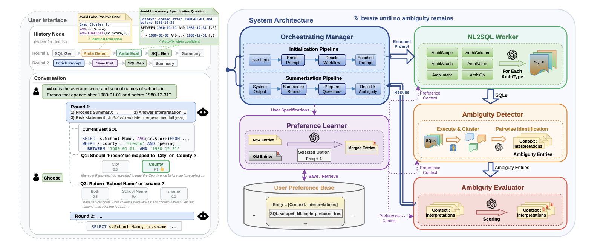
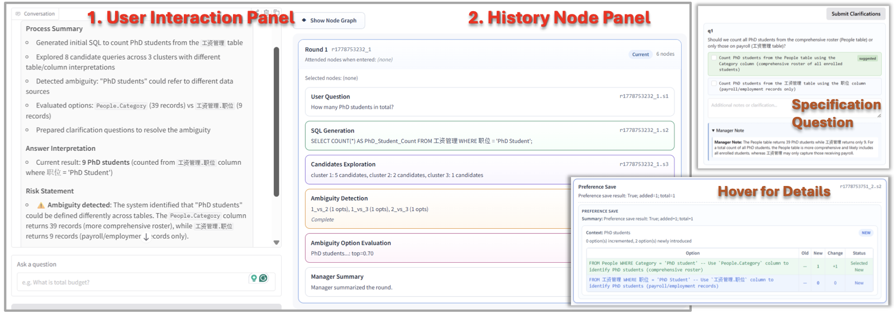
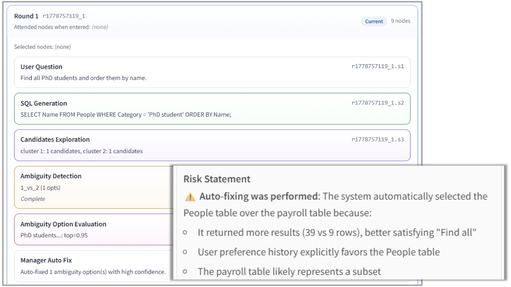

# PEARL — NL2SQL Ambiguity Resolution Demo

PEARL is a research prototype for execution-grounded ambiguity resolution in agentic text-to-SQL. It combines an LLM SQL worker, execution-based ambiguity detection, an ambiguity scorer, a preference learner, and an interactive demo UI.

## System architecture



## Demo UI



## Preference reuse (Case 2)



On a follow-up question, the saved preference favors the `People` table and the manager auto-fixes the ambiguity.

## Repository contents

- `pearl/` — core modules: NL2SQL worker, detector (candidate generation, embedding/LSH indexing, clustering, pairwise checks), evaluator, preference learner, manager, history nodes, compactor, database inspector, and Gradio UI.
- `examples/make_demo_db.py` — generates a fully synthetic SQLite fixture with a fixed seed.
- `examples/synthetic_demo.sqlite` — generated fixture; all names, project titles, identifiers, amounts and notes are fabricated.
- `examples/scenarios.md` — walkthroughs for the two demo questions and the same-result case.

Regenerate the fixture:

```bash
python3 examples/make_demo_db.py
```

## Built with

- [smolagents](https://github.com/huggingface/smolagents) — the manager's `ToolCallingAgent` and tool interface.
- [Gradio](https://github.com/gradio-app/gradio) — the interactive demo UI.
- SQLite — the demo database.

## Demo walkthroughs

See `examples/scenarios.md` for the example questions, the two interpretations of “PhD students”, and how preferences are reused on a follow-up question.
